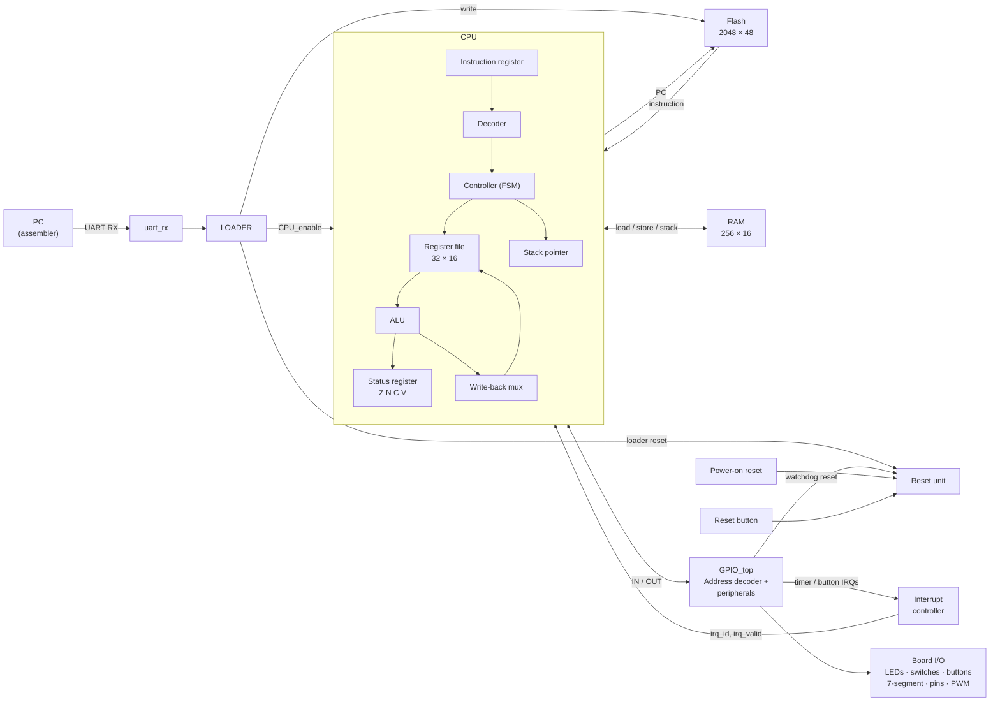

# 16-bit Microcontroller on FPGA

A custom 16-bit microcontroller designed from scratch in SystemVerilog and running
on a **Digilent Nexys A7** FPGA board at 100 MHz. It has its own instruction set,
a 3-stage pipeline, a 10-source interrupt controller and a set of memory-mapped
peripherals (GPIO, timers, PWM, watchdog, 7-segment display). Programs are written
in assembly and loaded into the chip over UART without re-synthesizing the design.

## Demo

<!-- Drag and drop the demo video here in the GitHub editor -->

## Features

- **CPU:** 16-bit data path, 32 general-purpose registers, 48-bit instructions, 41 instructions
- **Pipeline:** 3 stages (fetch, decode, execute) with flush on jumps, calls and interrupts
- **Memory:** 2048 × 48-bit program memory (flash), 256 × 16-bit data RAM, hardware stack in RAM
- **Interrupts:** 10 sources (5 timers, 5 buttons), per-source enable mask, fixed priority, global `EI` / `DI`
- **Peripherals:** 16 GPIO pins with direction control, 16 LEDs, 16 switches, 5 buttons with debouncer,
  binary-to-BCD and BCD-to-7-segment converters, 8-digit 7-segment display, 5 timers, PWM, watchdog
- **Reset sources:** power-on, reset button, watchdog, UART loader
- **Program loading:** UART bootloader (9600 baud) that writes programs into flash at runtime

## Block diagram



## Pipeline


Jumps, calls, returns and interrupts flush the instructions that are already in the
pipeline. For an interrupt, the address of the first instruction that has not been
executed is pushed to the stack, so execution continues from there after `RETI`.

## Instruction set

All instructions are 48 bits wide and share one format:

```
 47     42 41   37 36   32 31   27 26             11 10          0
+---------+-------+-------+-------+-----------------+-------------+
| opcode  |  Rd   |  Rs1  |  Rs2  |  immediate (16) | address (11)|
+---------+-------+-------+-------+-----------------+-------------+
```

| Group | Instructions |
|---|---|
| Arithmetic / logic | `ADD` `SUB` `ADDI` `SUBI` `INC` `DEC` `NEG` `CMP` `AND` `OR` `XOR` `NOT` `SHL` `SHR` |
| Data movement | `MOV` `MOVI` `SET` (Rd = FFFF) `CLR` (Rd = 0) `LOAD` `STORE` `PUSH` `POP` |
| I/O | `IN` `OUT` |
| Jumps | `JMP` `RJMP` `JZ` `JNZ` `JC` `JNC` `JN` `JP` `JLE` `JGE` (and relative versions `RJZ`, `RJNZ`, …) |
| Subroutines | `CALL` `RET` |
| Interrupts | `EI` `DI` `RETI` |
| Other | `NOP` `STOP` |

The ALU updates four status flags: **Z** (zero), **N** (negative), **C** (carry) and **V** (overflow).

## Memory map

| Region | Address | Notes |
|---|---|---|
| Interrupt vectors | flash 0 – 9 | One `JMP` per interrupt source |
| Program start | flash 11 | Execution starts here after reset |
| Program memory | flash 11 – 2047 | 48-bit words |
| Data RAM | 0x00 – 0xBF | 16-bit words |
| Stack | 0xFF down to 0xC0 | Grows downward, 64 words. On overflow the SP stops at 0xBF and further pushes overwrite address 0xBF |

## Interrupts

| Source | Mask bit | Vector (flash address) | Priority |
|---|---|---|---|
| Timer 0 | 0 | 9 | highest |
| Timer 1 | 1 | 8 | |
| Timer 2 | 2 | 7 | |
| Timer 3 | 3 | 6 | |
| Timer 4 | 4 | 5 | |
| Button up | 5 | 4 | |
| Button left | 6 | 3 | |
| Button center | 7 | 2 | |
| Button right | 8 | 1 | |
| Button down | 9 | 0 | lowest |

- `EI` / `DI` enable or disable all interrupts; the mask register (port 71) enables individual sources.
- Interrupts do not nest: a new interrupt waits until the current handler executes `RETI`.
- Only the return address is pushed. Status flags and registers are **not** saved automatically,
  so a handler must not disturb state that the interrupted code still needs
  (for example the flags between a `CMP` and the following conditional jump).
  This was a deliberate choice to keep the hardware simple.

## Peripherals (I/O ports)

Peripherals are accessed with `IN` and `OUT` through an address decoder.

| Peripheral | Ports |
|---|---|
| GPIO pins (in, out, direction) | 1, 2, 3 |
| LEDs | 4 |
| Switches | 5 |
| Buttons, button interrupt enable/disable, debouncer on/off | 6 – 10 |
| Binary-to-BCD converter | 21, 22 |
| BCD-to-7-segment converter | 23 – 27 |
| 7-segment digits / segments | 28, 29 |
| PWM (enable, disable, prescaler, duty cycle) | 32 – 35 |
| Timer 0 – 4 (enable, disable, interrupt, prescaler, max value) | 36 – 65 |
| Watchdog (enable, clear, prescaler, max value, disable) | 66 – 70 |
| Interrupt mask register | 71 |
| Timer 0 – 4 clear | 72 – 76 |
| Timer 0 – 4 read | 77 – 81 |

## Loading a program

Programs are written in assembly, assembled on the PC and sent to the board over UART.
The hardware side works as follows:

1. The assembler turns each instruction into a 64-bit packet:
   `[58:48]` flash address, `[47:0]` 48-bit instruction.
2. The PC sends each packet as 8 bytes over UART (9600 baud).
3. `uart_rx` receives the bytes (16× oversampling, majority voting, double-register synchronizer).
4. The `LOADER` collects 8 bytes into one packet and writes the instruction into flash at the given address.
5. A packet of all `1`s (`0xFFFF_FFFF_FFFF_FFFF`) ends loading: the loader enables the CPU, which starts at address 11.
6. While running, a packet of all `0`s resets the system and returns the loader to load mode,
   so a new program can be loaded without reprogramming the FPGA.

```
python assembler_load.py load program.asm      # assemble, upload, run
python assembler_load.py reload program.asm    # stop, upload, run
```

## Verification

The design was verified in simulation with a class-based SystemVerilog testbench
(`TESTBENCH/mcu_class_tb.sv`) in two phases:

**1. CPU core, checked against a reference model.** A generator builds directed and
random programs, a driver loads them into the MCU, and a scoreboard compares every
register write, flag update, RAM write and port write with a reference model of the CPU.

| Programs run | Register writes | Flag updates | RAM writes | Port writes | Mismatches |
|---|---|---|---|---|---|
| 53 (3 directed, 50 random) | 2491 | 1494 | 578 | 14 | 0 |

**2. Peripherals, directed scenarios.** 15 scenarios with 91 checks: LEDs and switches,
GPIO pins, BCD and 7-segment converters, timers, timer interrupts, `DI`, interrupt
priority, PWM duty cycle, watchdog, all reset sources, button debouncer and interrupts
of all five buttons, no-preemption of a running interrupt, and stack overflow.

**Result: all programs and all 91 checks passed; 9 assertions active, 0 failed.**

I developed the testbench with the help of AI tools.

## Tools

- **Assembler** (`TOOLS/assembler_load.py`): assembles `.asm` files and uploads them over UART
- **IDE** (`TOOLS/MCU_IDE.py`): simple editor with assemble and upload buttons (Tkinter)

Both tools require Python 3 and `pyserial`. They were developed with AI assistance;
the focus of this project is the hardware design.

## Build

- Vivado, target board Digilent Nexys A7 (100 MHz clock)
- Top module: `MCU_top`
- Constraints: `constraint/microcontroller.xdc`

<!-- Resource usage and timing (fill in from Vivado reports):
| LUTs | FFs | BRAM | WNS at 100 MHz |
|---|---|---|---|
|  |  |  |  |
-->

## Project structure

```
RTL/          SystemVerilog source (top: MCU_top.sv)
TESTBENCH/    class-based testbench
TOOLS/        assembler and IDE
constraint/   Nexys A7 pin constraints
EXAMPLES/     example assembly programs
```
